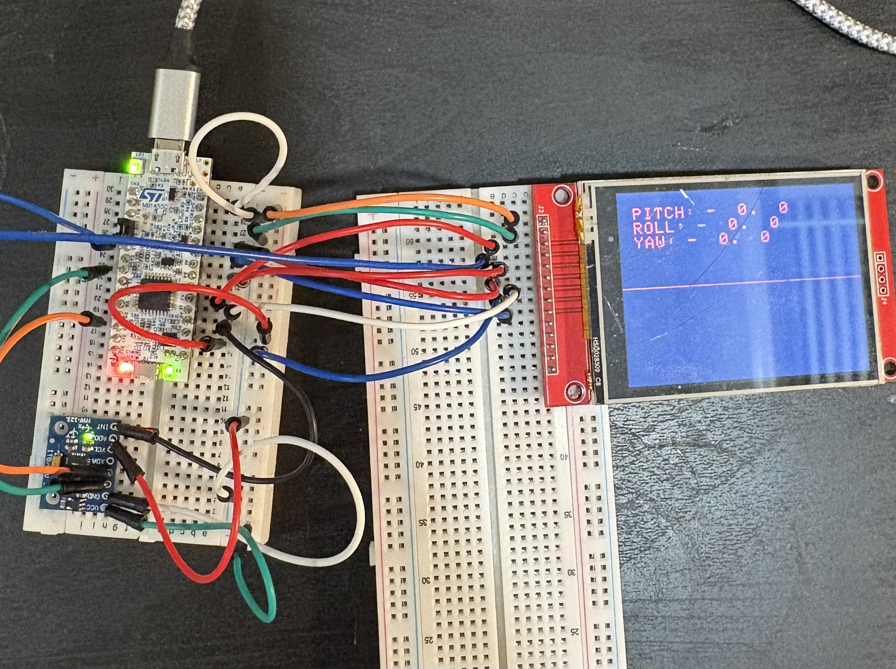
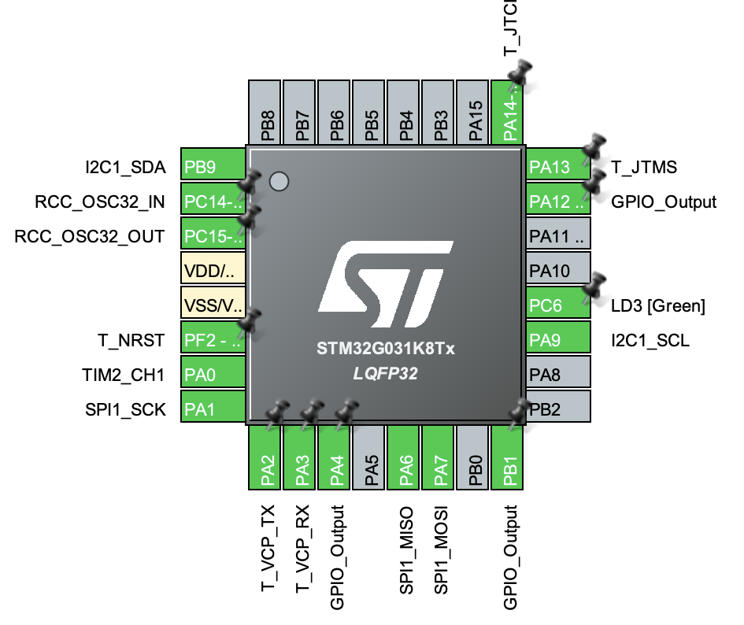

# AHRS

A 6-DOF Attitude Heading Reference System built on an STM32G031. 
Reads a 6-axis MPU-6050 over I2C DMA and approximates true pitch, roll, and, yaw via a Madgwick Filter. 
Draws an attitude read out and an artificial horizon on an SPI LCD. 
Runs on FreeRTOS v2.

## Features

- IMU sampling driven by the sensor's data-ready interrupt, captured by TIM2
  input capture (timestamp + trigger for the DMA read)
- I2C DMA burst read of accel, temp, and gyro registers
- Startup calibration: averages 500 samples for gyro bias and gravity alignment
- Madgwick orientation filter (quaternion state, Euler output)
- Artificial horizon and numeric attitude readout on a 320x240 SPI LCD
- Two FreeRTOS tasks: IMU processing and display, linked by a depth-1 queue
- Optional UART debug output (115200 baud)

## Hardware

| Part | Notes |
|------|-------|
| MCU board | NUCLEO-G031K8 (STM32G031K8, Cortex-M0+, 64 KB flash / 8 KB RAM) |
| IMU | MPU-6050 |
| Display | Adafruit ILI9341 |

## Software

| Path | Contents |
|------|----------|
| `Core/Src/main.c` | Peripheral init, ISR callbacks, thread creation |
| `Core/Src/imu_task.c` | IMU config, calibration, filter, IMU thread |
| `Core/Src/imu_math.c` | Vector and quaternion helpers |
| `Core/Src/display_task.c` | Display thread and horizon drawing |
| `Core/Src/lcd_driver.c` | SPI LCD driver (commands, text, lines) |

